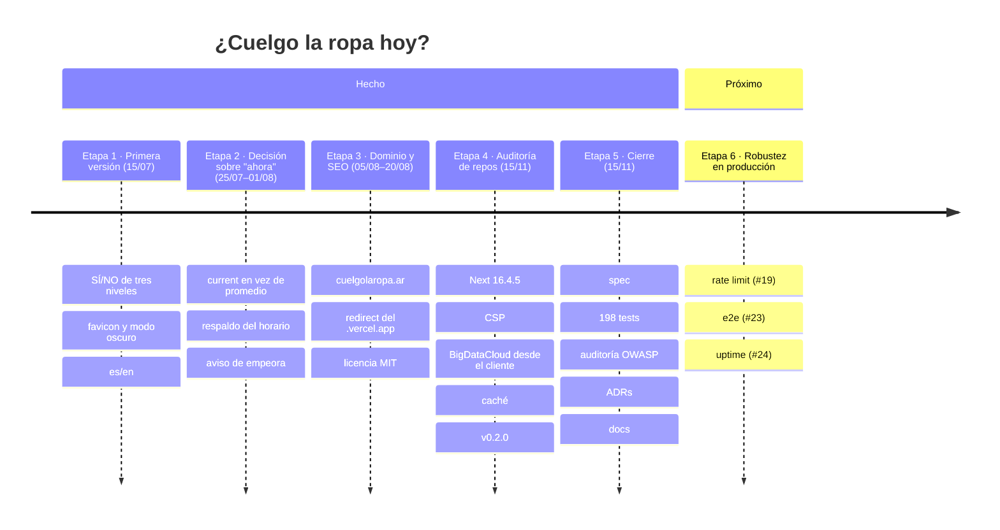

# ¿Cuelgo la ropa hoy? — handoff

**Estado:** en producción en cuelgolaropa.ar; responde SÍ/NO con geolocalización, ciudad escrita o Buenos Aires por defecto. Cerrado el 15/11/2026; en producción la v0.3.0. · **Última actualización:** 17/11/2026
**Lenguaje:** TypeScript (Next.js 16.4, React 19.3) · **Forma:** simple (una página, dos rutas, reglas puras en `src/lib/`)
**Correr:** `npm run dev` · **Tests:** `npm test` · **Deploy:** merge a `main` → Vercel deploya solo (producción = `main`, verificado el 15/11/2026)

Este proyecto no pasó por `/inicio-proyecto`: las etapas salen de `git log`.

## Roadmap

| Etapa | Qué incluye | Estado | Criterios (SPEC) |
|---|---|---|---|
| 1 · Primera versión | SÍ/NO, colores, es/en, 3 días, easter eggs | ✅ | CA-18, CA-22 |
| 2 · Decisión sobre "ahora" | reglas sobre `current`, aviso de empeora | ✅ | CA-1 a CA-9 |
| 3 · Dominio y SEO | dominio, OG, sitemap, redirect | ✅ | — |
| 4 · Auditoría de repos | Next al día, CSP, terceros, caché (#7, #8, #9) | ✅ | CA-10 a CA-17, CA-19, CA-20 |
| 5 · Cierre | spec, tests, rompedora, auditoría, docs | ✅ (#25, v0.3.0) | todos salvo CA-20 a CA-22 sin test |
| 6 · Robustez | rate limit, e2e, uptime | ⏳ | CA-20 a CA-22 |

## Qué se hizo (lo último arriba)
- 15/11 · #25 mergeado (`70f3e2a`), tag y release [v0.3.0](https://github.com/malenitaa/cuelgolaropa/releases/tag/v0.3.0). Producción deployó bien (home, `/api/weather` y `/api/geocode` en 200, CSP igual) y el primer `Audit` sobre `main` dio verde.
- 15/11 · Dependabot: mergeados #14 (React 19.3, Tailwind 4.3.5) y #15 (ESLint 10); cerrados #16 (TypeScript 7 rompe `typescript-eslint`) y #17 (`@types/node` 26, el runtime es Node 24). #18 hace que Dependabot no proponga majors de `@types/node`.
- 15/11 · Cierre: `docs/SPEC.md` (26 criterios), vitest con 198 tests, auditoría (`docs/AUDITORIA.md`), 6 ADRs, `SECURITY.md`, audit diario en la CI, plantillas de issues y PR, versión 0.3.0.
- 15/11 · La rompedora encontró dos bugs que se corrigieron: un 200 raro de Open-Meteo daba 500 sin JSON, y "constructor" se tomaba como easter egg. Además, sin humedad o viento ya no responde SÍ.
- 15/11 · #7, #8, #9 cerrados (v0.2.0); Dependabot ignora majors de `@types/node` (#18).

## Cómo retomar
`gh issue list --label ready --state open` y seguir por "Qué sigue". La doc interna está en `docs/interno/DISENO.md` (solo local, en `.gitignore`); si no está en la máquina, se reconstruye desde este HANDOFF, `docs/SPEC.md` y `docs/adr/`.

## Qué sigue
1. #20 · Prender Dependabot alerts, security updates y el reporte privado de vulnerabilidades (manual, 2 minutos).
2. #19 · Rate limit en el Firewall de Vercel y caché del lado del server.
3. #12 · Crédito a Open-Meteo en la página (lo pide su licencia).
4. #23 · Tests end-to-end de la página.
5. #24 · Uptime.

## Decisiones que tomé (para vetar)
- **Sin humedad, viento o código de "ahora", `/api/weather` responde 502 "El servicio de clima no devolvió datos suficientes"** en vez de una respuesta. Antes decía SÍ verde. `src/app/api/weather/route.ts`; CA-24.
- **Un 200 de Open-Meteo con otra forma se muestra como "el servicio de clima no respondió correctamente"** (502), en vez de un 500 sin texto. CA-23.
- **Resultados de geocoding sin coordenadas se saltean.** CA-26.
- **`@types/node` pasa de 20 a 24** (lo pide vitest 5 y es el Node de la CI). ADR-0006.
- **El README ahora dice que los logs de Vercel pueden tener la ubicación aproximada o la ciudad.** Antes decía "no se guarda".
- **Versión 0.3.0** en `package.json` (estaba en 0.1.0 aunque el tag ya era v0.2.0).
- **Casos raros aceptados** (coordenadas en hexa, emojis en el límite, `lang=EN`, etc.): `docs/AUDITORIA.md`, B-1 a B-5. Los tests los documentan tal cual se comportan.

## Para decidir
- #21 · ¿Ruleset que proteja `main`?
- #22 · ¿Redondear las coordenadas que van a BigDataCloud?
- **Orden de carpetas:** no moví nada. `src/app/page.tsx` tiene 721 líneas con UI y helpers del navegador (favicon, color, JSON-LD, BigDataCloud) juntos; separar los helpers a `src/lib/` facilitaría los tests e2e de #23, pero siempre se editan juntos. Si lo querés, va con #23.
- `README.privado.md` (en `.gitignore`) no está en este clon ni en la Mac: si existe en otro lado, lo que tenga va a `docs/interno/DISENO.md`.

## Pendientes y deudas conocidas
- Sin tests de la página (CA-20 a CA-22 a mano), #23.
- 9 vulnerabilidades moderadas solo de desarrollo (eslint/typescript-eslint).
- TypeScript 7 rompe `typescript-eslint` (#16 cerrado); esperar soporte.
- Observabilidad: nada mide errores ni caídas (#24).

## Dónde está todo
| Qué | Dónde |
|---|---|
| Spec y criterios | `docs/SPEC.md` |
| Decisiones | `docs/adr/INDICE.md` |
| Diseño interno | `docs/interno/DISENO.md` (en `.gitignore`, repo público) |
| Auditoría | `docs/AUDITORIA.md` |
| Para externos | `README.md`, `SECURITY.md` |
